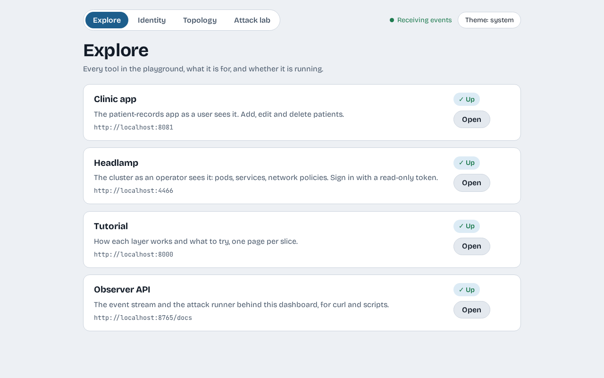

# Get started

We create a local cluster, deploy the clinic app, and open the dashboard that shows what is going on.

## Create the cluster

```console
$ make up
...
ready: k3d-ztp
```

This builds a k3d cluster named `ztp` and installs SPIRE. It took about two and a half minutes from nothing on the machine we tested. When it prints `ready: k3d-ztp`, the cluster is up.

## Deploy the clinic app

```console
$ make clinic
```

This builds one image, loads it into the cluster, and starts the app, the database, the MCP server, the agent and the attacker pod. Check that everything is running:

```console
$ make status
```

You should see these pods with the status `Running` (the random suffixes will differ):

```text
agents         agent-5b56cdc67c-j8hjz
attacker       attacker-5888f94d4f-zcn8c
clinic         billing-6cffd4cb9b-fv9h7
clinic         postgres-7568cccc-s89kr
clinic         records-api-55576dc7bf-lb6kw
clinic         records-mcp-bf8d4d6f8-4svhj
clinic         web-6586c45d8b-mrqrn
spire-server   spire-server-0
```

## Start the dashboard

The dashboard needs two processes. In one terminal:

```console
$ make observer
```

In a second terminal:

```console
$ cd web && npm install && npm run dev
```

Open <http://localhost:5173>. You land on **Explore**, which lists each tool, what it is for, and whether it is running.



The Tutorial card says Down until you serve this site with `make docs`, and Headlamp says Down until you start its port-forward. The card tells you the command to run.

!!! note "If it says Observer not reachable"
    The dashboard talks to the observer on port 8765. If `make observer` is not running, the status in the top right turns red and says so.

## Open the clinic app

```console
$ make web
```

Leave it running and browse to <http://localhost:8081>. You see a patient list with five people. The next page, [The open clinic](the-open-clinic.md), uses it.

!!! warning "Redeploying drops the connection"
    `make clinic` replaces the pods, and the port-forward from `make web` points at the old one. If the page stops loading after a redeploy, stop `make web` and start it again.

!!! warning "A cluster stopped for a day needs a reset"
    SPIRE's certificate authority lasts 24 hours. If you stop the cluster for longer and start it again, the SPIRE agent can no longer trust the server and pods wait for their identity. The reliable fix is to start over with `make down` and `make up`. A quicker one is to delete the `spire-agent` pod in the `spire-server` namespace, then restart the workloads that were waiting.

## Recap

- `make up` creates the cluster, and `make clinic` deploys the app.
- `make observer` and `npm run dev` give you the dashboard on port 5173.
- `make web` opens the clinic app on port 8081.

## Next steps

- [Workload identity](workload-identity.md) shows what SPIRE gives each workload.
- [The open clinic](the-open-clinic.md) uses the app and attacks it.
