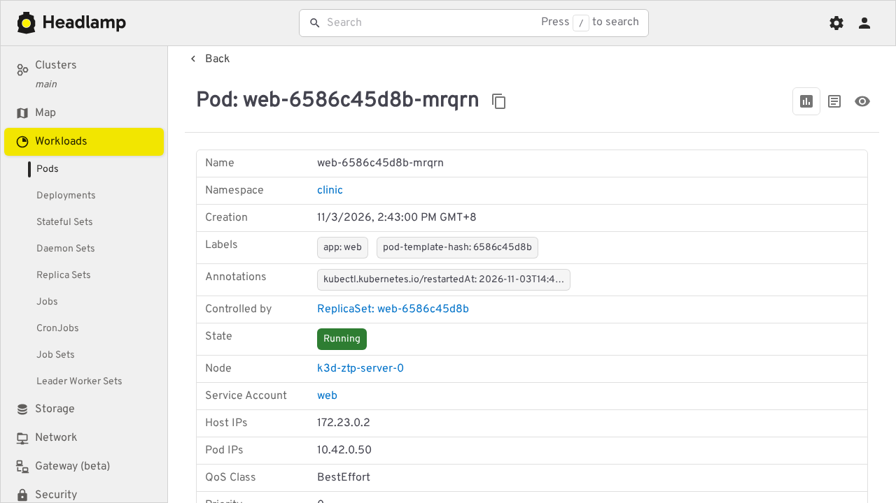
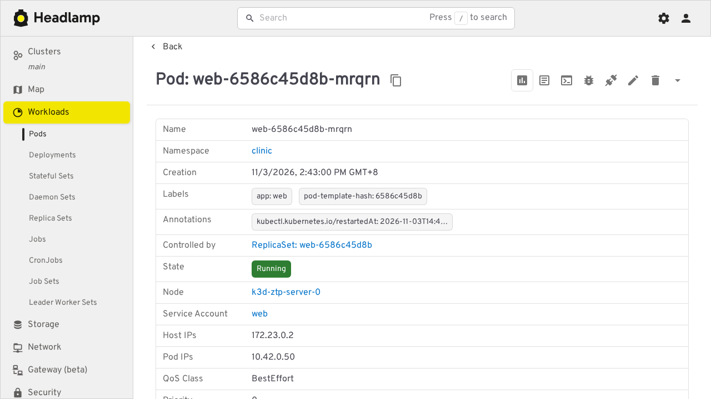

# How to read the cluster with Headlamp

This guide shows you how to look at the playground's cluster in Headlamp with a read-only login, and how to see what changes when the login is too powerful. It assumes the cluster is up (see [Get started](../get-started.md)).

## Install and open Headlamp

```console
$ make headlamp
$ make headlamp-ui
```

Leave the second command running and open <http://localhost:4466>. Headlamp asks for a token.

## Sign in read-only

In another terminal, print a token and paste it into the field:

```console
$ make headlamp-token
```

The token lasts one hour and comes from a service account bound to Kubernetes' built-in `view` role. Treat it like a password: do not paste it into a chat or commit it.

Once you are in, open **Workloads**, then **Pods**. You can see every pod, including `web`, `records-api`, `records-mcp`, `agent` and `postgres`. Open any pod and look at the icons at the top right.



Now open **Configuration**, then **Secrets**. The page says `Error: No permissions`. The `view` role cannot read Secrets, so the database password stays hidden even though the dashboard is open.

## See the same dashboard with too much power

Print an admin token and sign in again with it:

```console
$ ROLE=admin make headlamp-token
```

This creates a `cluster-admin` identity on demand. Open the Secrets page again: it lists the clinic's `db-static` secret. Open a pod: there are now icons for a terminal, debugging, port-forwarding, editing and deleting.



The dashboard did not change. Its identity did. A cluster dashboard can do exactly what the token it holds can do.

## Clean up the admin identity

Do not leave a standing cluster-admin account behind:

```console
$ kubectl --context k3d-ztp delete clusterrolebinding headlamp-admin
$ kubectl --context k3d-ztp -n headlamp delete serviceaccount headlamp-admin
```

## Related

- [Layered zero trust](../concepts/layered-zero-trust.md) covers why a privileged dashboard is itself part of the attack surface.
- [Make targets](../reference/make-targets.md) lists the Headlamp commands.
