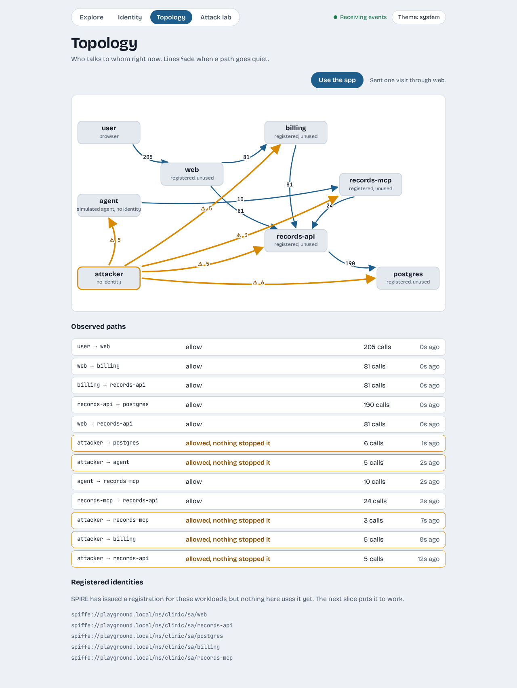
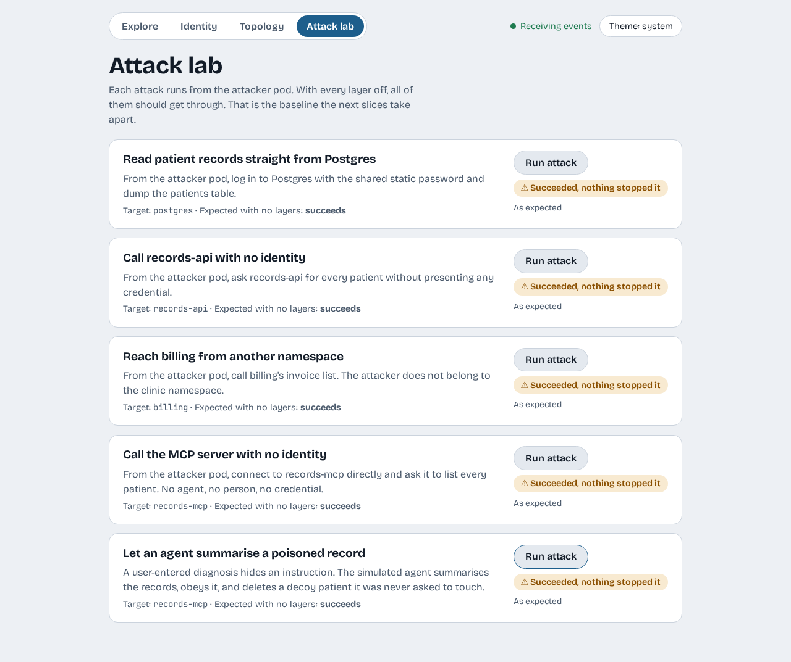

# The open clinic

We use the clinic app like a patient-records clerk, follow one change through the system, and then attack it. Nothing here is protected yet.

## Add, edit and delete a patient

With `make web` running, open <http://localhost:8081>.

1. Under **Add a patient**, enter a name, a date of birth and a diagnosis, then press **Add patient**. The status line says `Added <name>.` and a new row appears.
2. Press **Edit** on that row, change the diagnosis, and press **Save changes**.
3. Reload the page. The change is still there, because it is in the database and not only on the page.
4. Press **Delete** on the row.

At the bottom of the page you will see `Trace id of your last change`, followed by a 12-character id. Copy it for the next step.

!!! note "Bad input is refused"
    Try a name longer than 100 characters (remove the `maxlength` in your browser's inspector first). The server answers with a reason and nothing is saved. The page does not need to be the only line of defence, and here it is not.

## Follow the change through the services

Every request carries a trace id from the first service that sees it. Ask the observer for everything that happened under yours:

```console
$ curl -s "localhost:8765/events?follow=false&trace=5b3ff75be66b"
```

Replace the id with yours. Each event is one line of JSON starting with `data:`. Pulling out who called whom gives:

```text
web -> records-api  POST /patients  201
user -> web  POST /api/patients  201
```

Your browser called `web`, and `web` called `records-api`. The inner call appears first because each event is written when its request finishes.

Now open **Topology** in the dashboard and press **Use the app**. Lines appear for each hop, with a count, and the list underneath names every path.



## Attack it

Open **Attack lab** and run the first three attacks one at a time. Each one runs from the `attacker` pod, which belongs to no one and has no business in the clinic.



All three report **Succeeded, nothing stopped it**. In the same order:

1. **Read patient records straight from Postgres.** The attacker logs in with the shared database password and reads the table. The password is the same one `records-api` uses, and the database accepts connections from any pod.
2. **Call records-api with no identity.** The service answers anyone who asks. It never checks who is calling.
3. **Reach billing from another namespace.** The network lets any pod talk to any other.

Go back to **Topology**. The attacker's paths are amber and marked as allowed. Those amber lines are what the next slices set out to remove.

## Recap

- The clinic app is a real CRUD app: `web`, `records-api`, `billing` and Postgres.
- A trace id lets you follow one change across services.
- With no layers on, all three attacks succeed.

## Next steps

- [Agents and MCP](agents-and-mcp.md) adds an AI agent as a new kind of client.
- [Layered zero trust](concepts/layered-zero-trust.md) explains which layer answers each attack.
