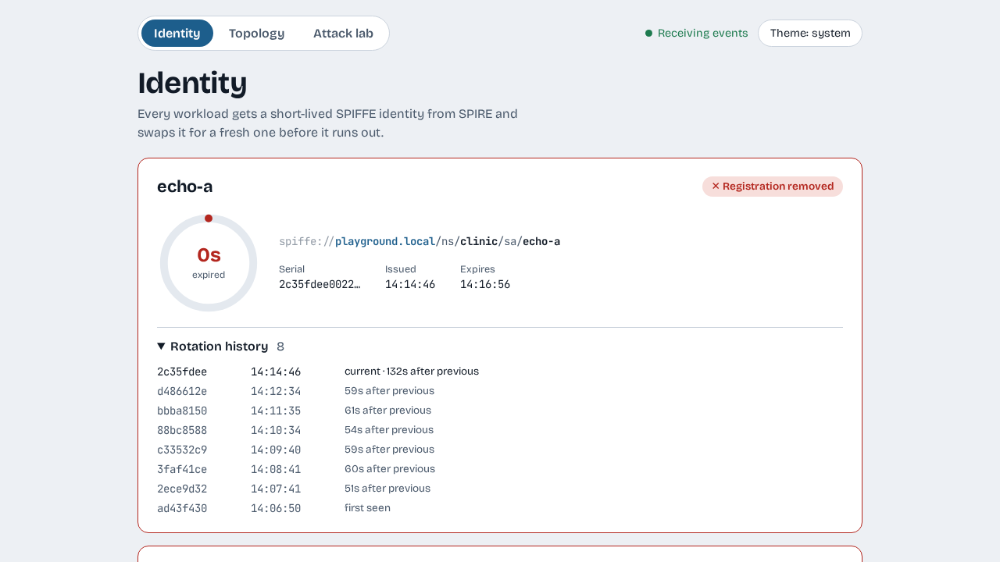

# Workload identity

We give two small workloads an identity from SPIRE and watch it rotate, then remove the registration and watch the identity run out.

## Start two workloads

```console
$ make echo
```

Each workload asks SPIRE for an identity when it starts. In the dashboard, open **Identity**. After a few seconds two cards appear, one for `echo-a` and one for `echo-b`.


Look at one card from left to right:

- The ring is the identity's remaining life. It drains as time passes.
- The line `spiffe://playground.local/ns/clinic/sa/echo-a` is the identity itself. The trust domain is `playground.local`, the namespace is `clinic`, and the service account is `echo-a`.
- The serial identifies this particular certificate.

## Watch a rotation

Wait about a minute. The ring refills with a short pulse, the serial changes, and a new row appears in the history.

Each identity lives for two minutes, and SPIRE replaces it at the halfway point, so a new serial arrives about every minute. In the history we saw gaps of 49 to 61 seconds between serials.

!!! note "Why so short?"
    Real deployments use hours. Two minutes means you can watch a rotation without waiting, and it shows the point of the design: a stolen identity stops working on its own soon after.

## Remove the registration

SPIRE only issues identities to workloads it has a registration for. Delete the registration for the `clinic` namespace:

```console
$ kubectl --context k3d-ztp delete clusterspiffeid clinic
clusterspiffeid.spire.spiffe.io "clinic" deleted
```

Within a few seconds both cards say **Registration removed**. Nothing is renewing the identities now, so the rings keep draining. After at most two minutes each card says **Identity expired** and its border turns red.



Put the registration back:

```console
$ make spire
```

The cards return to **Identity valid** after the next issue.

!!! warning "A fallback you might expect is switched off"
    The SPIRE chart ships a catch-all registration that would keep issuing identities after you delete ours, so this exercise would show nothing. The playground turns it off. With no registration there is no identity, which is the behaviour zero trust asks for.

## Recap

- A workload's identity is a certificate that names it, here `spiffe://playground.local/ns/clinic/sa/echo-a`.
- Identities are short-lived and replaced automatically about every minute.
- No registration means no identity, and the identity expires on its own.

## Next steps

- [The open clinic](the-open-clinic.md) deploys the real app. It does not use these identities yet, and that is the point.
- [Layered zero trust](concepts/layered-zero-trust.md) explains where identity fits among the layers.
